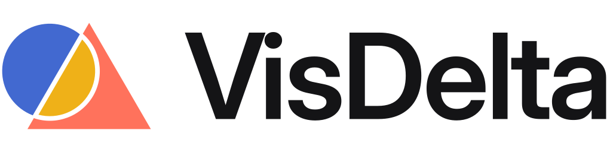
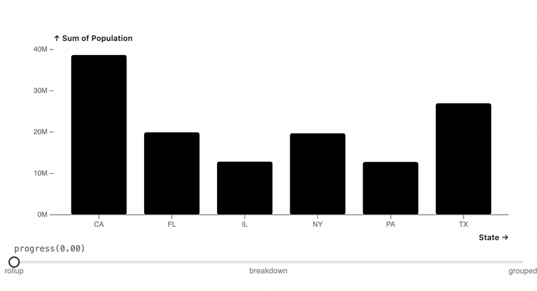

<h1 align="center">
  <a href="https://visdelta.songhai.site">
    <picture>
      <source media="(prefers-color-scheme: dark)" srcset=".github/brand/lockup-dark.svg" />
      
    </picture>
  </a>
</h1>

<p align="center"><b>Declare chart states. VisDelta tracks their objects and renders a transition you can play, reverse or scrub.</b></p>

<p align="center">
  <a href="https://visdelta.songhai.site">Website</a> ·
  <a href="https://visdelta.songhai.site/docs/quick-start/">Quick start</a> ·
  <a href="https://visdelta.songhai.site/docs/api/">API</a> ·
  <a href="https://visdelta.songhai.site/docs/guides/agent-workflow/">Agent guide</a> ·
  <a href="README.zh-CN.md">中文</a>
</p>



```sh
npm install visdelta
```

```js
import {bar, transition} from 'visdelta';
import 'visdelta/style.css';

const rows = [
  {product:'Atlas', revenue:84, profit:22},
  {product:'Beacon', revenue:62, profit:31},
];
const from = bar(rows).x('product').y('revenue');
const change = await transition(from, from.y('profit'), {
  target:'#chart', width:'auto', height:400,
});
change.progress(0.5);
// On removal: change.destroy();
```

Supply tidy data. The surrounding application owns its data preparation, page,
controls and intent. VisDelta owns chart declarations, identity, validation,
rendering and transitions. Import a selected chart from `visdelta/bar`,
`visdelta/line`, `visdelta/area`, `visdelta/point`, `visdelta/pie` or `visdelta/unit`
when you want only that module.

## Studio

One website contains four ways to use the same library:

- **Gallery** — static chart idioms, their data and minimal declarations.
- **Playground** — edit a declaration and inspect the live chart and transition.
- **Story** — copy complete scrollytelling websites; no narrative DSL or parser.
- **Liveshow** — edit the existing chart through MCP, with optional local text/voice AI.

Studio requires Node.js 22.18 or later.

```sh
npm ci
npm run dev
```

Open http://127.0.0.1:4347/. To serve a production build:

```sh
npm run studio:build
npm start
```

MCP is available locally at `/api/liveshow/mcp` while Liveshow is open. Any MCP
client can connect; it does not require the demonstration model. For the built-in
text/voice client, add `OPENAI_API_KEY` to a local `.env.local` and restart. Keys
stay on the server. Static hosting supports the Gallery, Playground, Story and
manual Liveshow controls; MCP and AI require the local service.

## Source and checks

- `src/` — independently usable library.
- `website/` — Studio, public documentation and optional AI demonstration.
- `examples/story/` — ordinary websites using the public API.
- `integrations/mcp/` — a thin MCP tool adapter over a browser bridge.
- `docs/internal/` — architecture and engineering evidence.

Public documentation has one editable source: `website/content/docs/`. Builds
generate the package's version-matched Markdown and hashes under `dist/docs/`.
Read `visdelta/docs/index.json` to discover those documents without network access.

```sh
npm test                    # library, examples, docs, package and unit contracts
npm run render:check        # real browser rendering and lifecycle
npm run pack:check          # isolated installed-package and type contracts
npm run test:studio         # MCP/AI server and Studio browser contracts
```

VisDelta is MIT licensed.

<br />

<!-- series-footer:start -->

<p align="center">
<a href="https://syuze.songhai.site"></a>&nbsp;
  <a href="https://news-metro.songhai.site"></a>&nbsp;
  <a href="https://narrative-graph.songhai.site"></a>&nbsp;
  <a href="https://visdelta.songhai.site"></a>&nbsp;
  <a href="https://cytocausal.songhai.site"></a>&nbsp;
  <a href="https://aethel.songhai.site"></a>
</p>

<p align="center"><a href="https://github.com/SonghaiFan/perspectiva">Perspectiva</a> · <a href="https://github.com/SonghaiFan/access">Access</a></p>

<p align="center"><sub>Frank series · Made by <a href="https://github.com/SonghaiFan">Songhai Fan</a></sub></p>

<!-- series-footer:end -->

<p align="right">
  <picture>
    <source media="(prefers-color-scheme: dark)" srcset=".github/brand/frank-signature-dark.svg" />
    
  </picture>
</p>
