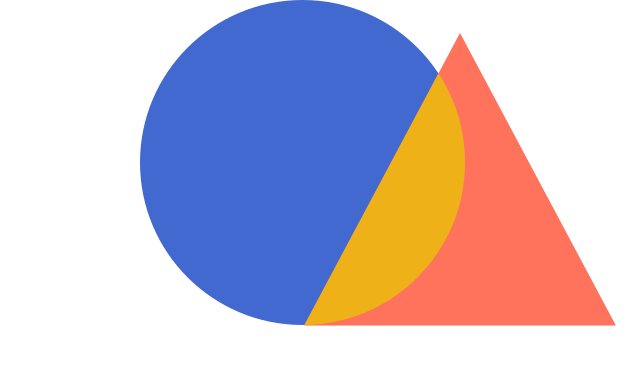

<p align="center">
  
</p>

# VisDelta

VisDelta is a declarative visualization-transition library. Describe a chart
before and after a change; VisDelta finds the difference and lets any external
control play or seek the transition.

> This project is evolving quickly and will remain free and open source forever. If you’ve downloaded it or are using it, please **Star** the repository and [**Follow @SonghaiFan**](https://github.com/SonghaiFan) to keep up with my projects. Your Star is my biggest source of support and motivation to keep building.

<p align="center">
  
</p>

Every frame above is `change.progress(t)` — the same frames play forward,
backward, or under a scrollbar. Try it in the [documentation and playground](https://songhaifan.github.io/visdelta/).

```text
Data -> Chart state -> Difference -> Transition -> Frame
```

```js
import { bar } from "visdelta/bar";
import { transition } from "visdelta/transition";
import "visdelta/style.css";

const revenue = bar(rows)
  .x("category")
  .y("revenue");

const profit = revenue.y("profit");
const change = await transition(revenue, profit, {
  target: "#chart"
});

change.progress(0.42);
change.play({ duration: 800 });
```

Chart states are immutable: creating `profit` does not change `revenue`.

## Install

```sh
npm install visdelta@0.3.0
```

Or import it directly in a browser, using the same jsDelivr `+esm` convention
as D3:

```html
<link rel="stylesheet" href="https://cdn.jsdelivr.net/npm/visdelta@0.3.0/dist/visdelta.css">
<script type="module">
  import * as vd from "https://cdn.jsdelivr.net/npm/visdelta@0.3.0/+esm";

  const state = vd.bar(rows);
</script>
```

See the [complete CDN example](https://songhaifan.github.io/visdelta/docs/guides/cdn/) for a slider-controlled
transition and the optional focused entry points.

VisDelta depends only on the `d3-*` modules it renders with. Declared transforms
such as `.where()`, `.sort()`, `.breakdown()`, and `.rollup()` run without any
extra package. The package is ESM-only.

VisDelta expects tidy input. Data cleaning and reshaping belong before the
library.

## Chart types

| Import | Use |
| --- | --- |
| `visdelta/area` | Ordered magnitude and composition |
| `visdelta/bar` | Categorical comparison |
| `visdelta/line` | Ordered trends |
| `visdelta/point` | Relationships between quantities |
| `visdelta/unit` | Countable items in `grid`, `force`, `bar`, or `beeswarm` layouts |

The chart modules are peers. Each owns its builder, compiler, marks, axes,
matching, and transition rules. Core has no branches for built-in chart types.

```js
base.where({ region: "North" })     // remove other rows
base.highlight({ region: "North" }) // keep rows; change attention
base.focus({ region: "North" })     // keep rows; move the camera
```

Every visual mapping is explicit. VisDelta can supply presentation defaults,
but it never decides that a data field should mean x, y, color, size, or detail.

## Public entries

| Entry | Responsibility |
| --- | --- |
| `visdelta` | All built-in builders plus the core API |
| `visdelta/core` | State normalization, data types, camera math, and `delta()` |
| `visdelta/transition` | `transition()`, seek, play, pause, resize, and destroy |
| `visdelta/area`, `/bar`, `/line`, `/pie`, `/point`, `/unit` | Focused chart modules |
| `visdelta/plugins` | Define and register independent chart modules |
| `visdelta/chart-style` | Structural chart-style modules |
| `visdelta/browser` | Browser-global dependency adapter |
| `visdelta/style.css` | Required chart styles |

## Design rules

- Every frame is true: marks, scales, ticks, grid lines, and titles agree.
- Exit marks before changing the scale; change the scale before entering marks.
- Canonical reversible paths use the same frames backward; explicit directional easing profiles are an exception (see [design rules](docs/language-framework.md#reverse-means-the-same-frames-backward)).
- `focus()` is a camera move, never a data filter.
- Core stays chart-agnostic; chart-specific behavior stays in its module.

Read the [documentation](https://songhaifan.github.io/visdelta/docs/), the
[API reference](https://songhaifan.github.io/visdelta/docs/api/) and the
[playground](https://songhaifan.github.io/visdelta/docs/examples/playground/).
The [design principles](docs/language-framework.md) are the semantic
constitution the implementation follows.

## Development

```sh
npm ci
npm run check
npm run build
npm run docs:check
npm run test:browser
```

The documentation site lives in [`website/`](website/README.md), a separate
Fumadocs project that renders live examples with the built library:

```sh
npm run build
cd website
npm ci
npm run dev
```

See [CONTRIBUTING.md](CONTRIBUTING.md) before adding a chart type. Generated
`dist/`, site output, test results, and screenshots are not source files.

Released under the MIT License.


Pie and donut charts are available through `visdelta/pie`:

```js
import { pie } from 'visdelta/pie';
const chart = pie([{ part: 'A', value: 25 }, { part: 'B', value: 75 }])
  .value('value').color('part').key('part').innerRadius(0.75);
```

See [Design comparisons](docs/design-guides.md) for contextual alternatives,
runnable data and code, and seekable arc examples.
