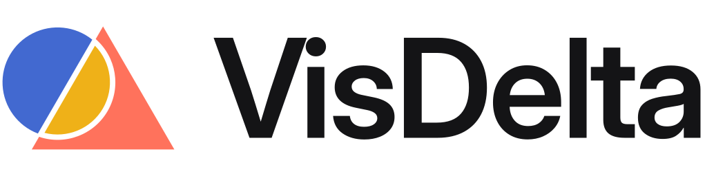
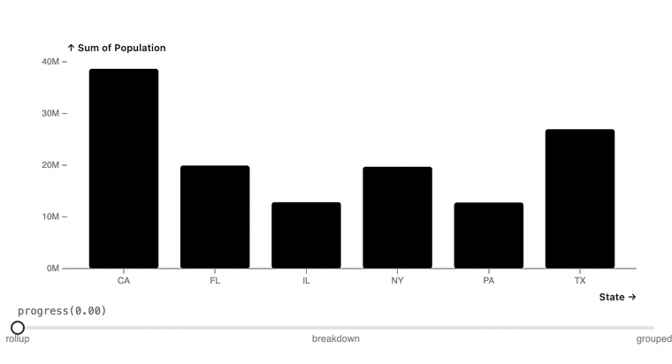

<h1 align="center">
  <a href="https://visdelta.songhai.site">
    <picture>
      <source media="(prefers-color-scheme: dark)" srcset=".github/brand/lockup-dark.svg" />
      
    </picture>
  </a>
</h1>

<p align="center"><b>声明图表的状态。VisDelta 追踪其中的对象，生成可以播放、倒放和拖动的过渡。</b></p>

<p align="center">
  <a href="https://visdelta.songhai.site">网站</a> ·
  <a href="https://visdelta.songhai.site/docs/quick-start/">快速开始</a> ·
  <a href="https://visdelta.songhai.site/docs/api/">API</a> ·
  <a href="https://visdelta.songhai.site/docs/guides/agent-workflow/">Agent 指南</a> ·
  <a href="README.md">English</a>
</p>



```sh
npm install visdelta
```

```js
import {bar, transition} from 'visdelta';
import 'visdelta/style.css';

const rows = [
  {product:'Atlas', revenue:84, profit:22},
  {product:'Beacon', revenue:62, profit:31},
];
const from = bar(rows).x('product').y('revenue');
const change = await transition(from, from.y('profit'), {
  target:'#chart', width:'auto', height:400,
});
change.progress(0.5);
// 移除时：change.destroy();
```

传入整洁（tidy）的数据。外层应用负责数据准备、页面、控件和意图；VisDelta 负责图表声明、对象身份、校验、渲染和过渡。如果只需要某一种图表，可以从 `visdelta/bar`、`visdelta/line`、`visdelta/area`、`visdelta/point`、`visdelta/pie` 或 `visdelta/unit` 单独引入。

文档网站目前只有英文。

## Studio

一个网站里有四种使用同一个库的方式：

- **Gallery**：静态的图表范式，以及它们的数据和最简声明。
- **Playground**：编辑声明，查看实时的图表和过渡。
- **Story**：复制完整的滚动叙事网站；没有叙事 DSL，也没有解析器。
- **Liveshow**：通过 MCP 编辑现有图表，可选本地文字或语音 AI。

Studio 需要 Node.js 22.18 或更新版本。

```sh
npm ci
npm run dev
```

打开 http://127.0.0.1:4347/。运行生产构建：

```sh
npm run studio:build
npm start
```

打开 Liveshow 时，本地的 `/api/liveshow/mcp` 提供 MCP 服务。任何 MCP 客户端都可以连接，不依赖演示用的模型。要使用内置的文字/语音客户端，在本地 `.env.local` 中加入 `OPENAI_API_KEY` 并重启。密钥只保存在服务器端。静态托管支持 Gallery、Playground、Story 和手动的 Liveshow 控件；MCP 和 AI 需要本地服务。

## 源码与检查

- `src/`：可以独立使用的库。
- `website/`：Studio、公开文档和可选的 AI 演示。
- `examples/story/`：使用公开 API 的普通网站。
- `integrations/mcp/`：基于浏览器桥接的轻量 MCP 工具适配层。
- `docs/internal/`：架构和工程依据。

公开文档只有一个可编辑的源：`website/content/docs/`。构建时会在 `dist/docs/` 下生成与包版本一致的 Markdown 和哈希。读取 `visdelta/docs/index.json` 可以在离线状态下找到这些文档。

```sh
npm test                    # 库、示例、文档、包和单元约定
npm run render:check        # 真实浏览器中的渲染与生命周期
npm run pack:check          # 隔离安装后的包与类型约定
npm run test:studio         # MCP/AI 服务器和 Studio 浏览器约定
```

VisDelta 采用 MIT 许可。

<br />

<!-- series-footer:start -->

<p align="center">
<a href="https://syuze.songhai.site"></a>&nbsp;
  <a href="https://news-metro.songhai.site"></a>&nbsp;
  <a href="https://narrative-graph.songhai.site"></a>&nbsp;
  <a href="https://visdelta.songhai.site"></a>&nbsp;
  <a href="https://cytocausal.songhai.site"></a>&nbsp;
  <a href="https://aethel.songhai.site"></a>
</p>

<p align="center"><a href="https://github.com/SonghaiFan/perspectiva">Perspectiva</a> · <a href="https://github.com/SonghaiFan/access">Access</a></p>

<p align="center"><sub>Frank series · Made by <a href="https://github.com/SonghaiFan">Songhai Fan</a></sub></p>

<!-- series-footer:end -->

<p align="right">
  <picture>
    <source media="(prefers-color-scheme: dark)" srcset=".github/brand/frank-signature-dark.svg" />
    
  </picture>
</p>
